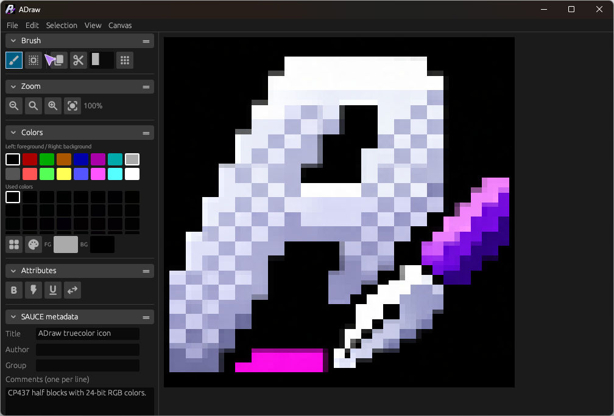

# ADraw

ADraw is a desktop editor for ANSI art on Windows, Linux, and macOS. Draw with character brushes,
type directly on the canvas, and add lettering with TheDraw fonts.

## Get started

1. Download the package for your system from the
   **[latest release](https://github.com/mikehodgson/adraw/releases/latest)**:
   Windows installer/portable ZIP, Linux archive, or macOS app archive.
   Linux and macOS packages will be available starting with the next release.
2. Choose **File > New image** to start an **80 x 25** canvas.
3. Pick a character and colors in the sidebar. **Left-click** a color for
   foreground; **right-click** for background.
4. Click or drag on the canvas to draw, or click a cell and type.
5. Choose **File > Save as...** to save your artwork as an `.ans` file.

For custom image sizes, editing shortcuts, and step-by-step feature
instructions, read the **[User guide](USER_GUIDE.md)**.

Supports Windows 10/11 x64, Linux x64/ARM64 (Ubuntu 22.04 or compatible newer
desktop), and macOS 11+ on Intel/Apple Silicon. Windows installation needs no
administrator rights. Close ADraw before upgrading. Builds are not
publisher-signed or notarized; download from the official release page and see
the [User guide](USER_GUIDE.md) for platform setup and security prompts.

## Main features

- Custom canvas sizes, character brushes, and direct keyboard editing.
- CP437 and UTF-8 support, with a bundled IBM VGA 9x16 display font.
- 16-color, 256-color, and truecolor palettes, plus swatches of artwork colors.
- Selections, drag-to-move, styled copy/paste, undo/redo, and selection-only saves.
- A persistent TheDraw TDF font library with searchable selection and text previews.
- Proportional zoom and a reorderable, collapsible sidebar.
- ANSI file loading/saving and SAUCE artwork credits.
- Rendered PNG and JPEG exports of the full artwork or active selection.

## Learn more

- **[User guide](USER_GUIDE.md):** detailed instructions and file compatibility.
- [Changelog](CHANGELOG.md): unreleased changes and release history.
- [Developer guide](https://github.com/mikehodgson/adraw/blob/main/DEVELOPERS.md):
  source builds, testing, architecture, and credits.

Code is MIT-licensed. The bundled IBM VGA font is by VileR, licensed under
CC BY-SA 4.0; see the included license notices.
