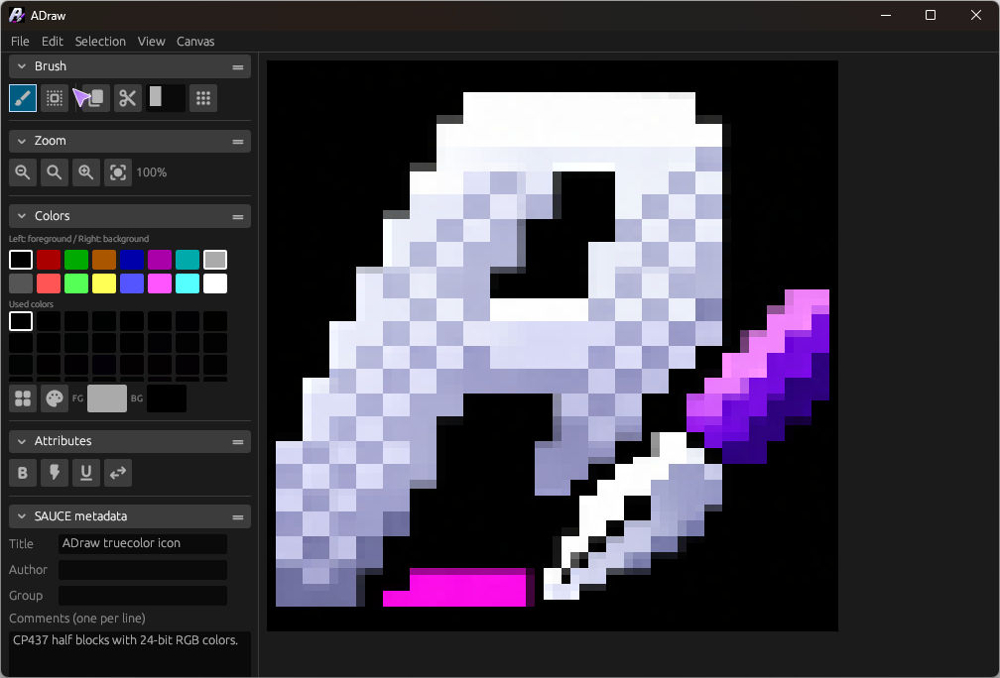
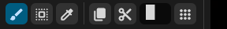
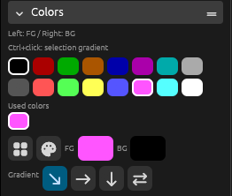
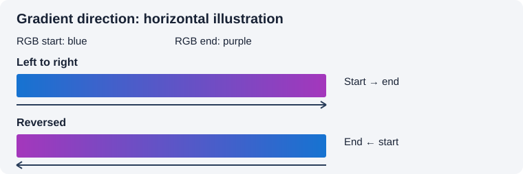
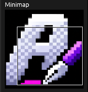

# ADraw user guide

Make ANSI art with character brushes, colors, and TheDraw lettering. For a
quick start and downloads, see the [README](README.md) or the
[ADraw website](https://adraw.outworldbbs.com/).



On macOS, use **Command** wherever this guide says **Ctrl**. Redo is
**Command+Shift+Z** (Command+Y also works). Hover over sidebar icons for their
names and shortcuts.

**Jump to:** [Setup](#get-set-up) · [Drawing](#create-draw-and-type) ·
[Colors and gradients](#colors-and-attributes) · [Selections](#select-move-and-paste) ·
[Files and export](#open-save-and-export) · [SAUCE](#sauce-credits) ·
[Workspace](#zoom-minimap-and-sidebar) · [TheDraw fonts](#lettering-with-thedraw-fonts)

## Get set up

- **Windows:** Run the installer, or extract the portable ZIP and run
  `adraw.exe`. The installer normally uses `%LOCALAPPDATA%\Programs\ADraw`,
  adds a Start menu shortcut, and offers an optional desktop shortcut.
  Close ADraw before updating. Uninstall through **Windows Settings > Apps**;
  upgrades and uninstall leave your artwork, preferences, and imported fonts
  intact. A DirectX 12, Vulkan, or OpenGL 3.3-capable graphics driver is
  required.
- **Linux:** Extract the `linux-x64` or `linux-arm64` archive and run `./adraw`.
  You need Ubuntu 22.04 or a compatible newer desktop, glibc 2.35+, X11 or
  Wayland, and a Vulkan or OpenGL-capable driver (OpenGL 3.3 or OpenGL ES 3.0
  or newer). These packages are not static binaries or AppImages.
- **macOS:** Extract `macos-arm64` for Apple Silicon or `macos-x64` for Intel,
  then move `ADraw.app` to Applications. macOS 11+ and a Metal-capable device
  are required. The app is ad-hoc signed, not Developer ID signed or
  notarized. If macOS blocks a trusted official download after you try to open
  it, use **System Settings > Privacy & Security > Open Anyway**. Do not
  disable Gatekeeper globally.

Linux file dialogs need `libdbus-1`, a running D-Bus session, and
`xdg-desktop-portal` with a desktop backend. Install `zenity` as a fallback.
On Ubuntu, install missing runtime packages with:

```sh
sudo apt install libvulkan1 mesa-vulkan-drivers libgl1 libegl1 libxkbcommon0 libxkbcommon-x11-0 libwayland-client0 libxcursor1 libxi6 libxrandr2 libdbus-1-3 xdg-desktop-portal xdg-desktop-portal-gtk zenity
```

ADraw checks official GitHub releases at startup. **Download update** opens the
release page; nothing is downloaded or installed automatically. Dismiss the
notice to keep editing; it may return next launch. Offline checks don't interrupt
your work. Use **About > Check for updates** to check manually and see the
result; if a check is running, wait for it to finish.

## Create, draw, and type

**File > New image** starts an 80 × 25 canvas. To change its size, set **Width**
and **Height** in the **Canvas** menu and choose **Resize canvas**. Resizing is
undoable. Large or zoomed images scroll without changing their saved size.



The **Brush** tools are, from left: Draw, Select, Eyedropper, Copy, Cut, the
brush character, and the CP437 character picker.

Choose a character in the brush field or the **CP437 character picker**. In
**Draw** mode, click or drag to paint; click a cell and type to enter text using
the current brush colors and attributes.

| Key | Action |
| --- | --- |
| Arrows | Move the cursor |
| Enter | Start another row |
| Backspace / Delete | Erase characters |
| Ctrl+Z / Ctrl+Y | Undo / redo |

Choose **Eyedropper** in the sidebar or **Edit** menu to pick a displayed
color: left-click a cell for foreground, right-click for background. It picks
what you see, including the effect of bold, blink, and inverse, without
changing the artwork.

## Colors and attributes

Left-click a swatch for foreground; right-click for background. Use the inline
16-color palette, the **256-color** button, or the RGB button/current-color
swatches for truecolor. Opening an RGB picker alone doesn't change the color.

**Used colors** remembers colors you pick during this session, not every color
in the artwork. RGB picks appear when the picker closes; gradient endpoints
are included. The list clears when ADraw closes.

With a selection active, choosing a color also recolors that foreground or
background throughout the selection without changing its characters,
attributes, or other color. Each choice, including an RGB adjustment, is one
undo step.

The **Attributes** buttons set bold, blink/iCE, underline, and inverse. Blink
is saved but not animated in the editor.

### Make a gradient

1. Pick a foreground or background start color.
2. Select an area, dragging from the desired start toward the end.
3. Hold **Ctrl** and left-click an end color for a foreground gradient, or
   right-click for a background gradient. This works in all palettes. To use
   RGB, Ctrl+click the RGB button or current-color swatch; in an already-open
   picker, hold Ctrl while choosing the end color.



The brush color stays unchanged, so you can try other endpoints. The gradient
normally follows the selection drag, including diagonals. **Select all** runs
from top-left to bottom-right. Use the **Gradient** controls under the colors
to follow the drag, run horizontally or vertically, or reverse the direction.
If the selection and artwork haven't changed since the latest gradient,
changing these controls redraws it in place.



Two 16-color endpoints produce 16-color steps; a 256-color endpoint uses
nearest 256-color steps, and an RGB endpoint produces truecolor. The other
color, characters, and attributes stay intact. Each gradient is one undo step.

## Select, move, and paste

Choose **Selection > Rectangular selection** and drag. Use **Select all** or
**Deselect** in the same menu.

| Task | How |
| --- | --- |
| Copy / cut | Select an area, then press **Ctrl+C / Ctrl+X** |
| Paste | In Select mode, click the destination and press **Ctrl+V**. If it is inside the existing selection, deselect first. |
| Move | Drag inside the selection and release |

Copies within ADraw preserve characters, colors, and attributes; external text
uses the brush style. Pasted areas must fit on the canvas. Moving clears the
original area and overwrites the destination, including blank cells. Moves,
cuts, and pastes are undoable.

## Open, save, and export

Choose **File > Encoding** before opening or saving: **CP437** for classic
ANSI/BBS art, or **UTF-8** for Unicode. The intended viewer must support the
encoding and colors you use. Some graphical CP437 control characters cannot
be saved safely in CP437 ANSI; choose UTF-8 if ADraw reports this. The bundled
IBM VGA 9x16 font displays CP437; other Unicode glyphs use system fallback
fonts and may look different across systems.

**File > Open...** loads `.ans` or `.asc` artwork. The file's SAUCE dimensions
take precedence; without a width, ADraw uses 80 columns, and without a height it
infers the rendered rows. Trailing line breaks don't add empty rows; an empty
file opens at 80 × 1.

Use **File > Save as...** to choose an ANSI file, then **Save** for subsequent
changes. **Save selection as...** creates a separate cropped ANSI file with
the selection's dimensions and artwork credits; it doesn't save or replace the
full image.

### Export PNG or JPEG

Choose **File > Export PNG...** or **Export JPEG...**. The active selection
is exported if there is one; otherwise, the whole canvas is exported. Keep the
ANSI file for editing: exporting doesn't save changes or alter the artwork,
selection, save path, or undo history.

Exports render at 9 × 16 pixels per cell regardless of zoom. They include
colors and attributes, with blink shown as steady text, but not the cursor,
selection outline, sidebar, or SAUCE metadata. PNG preserves pixels; JPEG
uses quality 90 and can soften details. Exports are limited to 32 megapixels;
select a smaller area if needed. Missing display-font glyphs produce an error
instead of a substituted glyph.

### Convert from a terminal

`adraw my-screen.ans` opens artwork in the editor. To render without opening
the editor:

```text
adraw --png my-screen.ans        # writes my-screen.png
adraw --jpeg art/*.ans           # writes art/<name>.jpg for each file
```

Images are written beside their sources, **replacing existing images** with
the same names. Input defaults to CP437; add `--utf8` for UTF-8, and put `--`
before filenames beginning with `-`. Conversion renders the full canvas as
above. Errors are reported per file; other files are still processed and the
command exits with a non-zero status if any fail. Run `adraw --help` for
options. Windows PowerShell and Command Prompt don't wait for ADraw; in
scripts use `Start-Process adraw -ArgumentList '--png','my-screen.ans' -Wait`.

### Open from a file manager

ADraw can be offered for `.ans` and `.asc` files without replacing your default
application:

- **Windows:** The installer offers **Open with ADraw** in Explorer's context
  menu (enabled by default). On Windows 11, first choose **Show more options**.
  Uninstall removes it; the portable ZIP doesn't register it.
- **Linux:** Run `./install.sh` from the extracted directory to install for
  your user and add an **Open With** choice. Add `~/.local/bin` to `PATH` for
  terminal use. Run `./install.sh --uninstall` to remove it.
- **macOS:** In Finder, choose **Open With > ADraw** after moving the app to
  Applications.

## SAUCE credits

Edit title, author, group, and comments in **SAUCE metadata**, with one
comment per line. For a file without SAUCE, choose **Add SAUCE metadata**.
Credits and dimensions are stored with the file, not drawn on the canvas.
Saving preserves existing metadata along with your edits and current
dimensions; selection saves use the cropped dimensions.

## Zoom, minimap, and sidebar

Use the sidebar zoom buttons or **View** menu. The spyglass opens a slider;
the actual-size button returns to 100%. Zoom ranges from 50% to 400% without
changing the artwork.

| Shortcut | Action |
| --- | --- |
| Ctrl++ / Ctrl+- | Zoom in / out |
| Ctrl+0 | Actual size |

Choose **View > Show minimap** for an overview on the right. Its outline shows
the visible canvas: click to jump, drag the outline to scroll, or drag the
minimap's left edge to resize it. Visibility is remembered between sessions.



Collapse a sidebar section with its left arrow; drag its right-hand handle to
reorder it. Press **Esc** to cancel a drag, or hold near an edge to scroll.
Order and collapsed state are saved automatically.

## Lettering with TheDraw fonts

1. Unzip your font collection. Choose **Edit > TheDraw fonts... > Import TDF
   files...** and select one or more `.tdf` files.
2. Choose a font, optionally filter with **Search fonts**, then enter text and
   adjust spacing while watching the preview.
3. Click the canvas destination and choose **Place text**. The lettering must
   fit; transparent cells leave the artwork underneath untouched. Placement is
   undoable and selects the lettering for further editing or saving.

Block and outline fonts use brush colors; color fonts keep their own. Text can
span lines, but only characters defined in the font are available (ASCII, not
arbitrary Unicode). Outline fonts use one classic mixed single/double-line
style. TDF collections aren't included with ADraw; the IBM VGA display font is
bundled separately.

Imported files are copied into application data and loaded on future launches;
you can move or remove the originals. Identical reimports reuse the saved copy,
while files with the same name but different contents are kept separately.
Import or restore failures are reported. Placed lettering is ordinary artwork
and doesn't need the font to be viewed.

Font locations: `%APPDATA%\ADraw\data\fonts` on Windows,
`~/.local/share/adraw/fonts` on Linux (or `$XDG_DATA_HOME/adraw/fonts`), and
`~/Library/Application Support/ADraw/fonts` on macOS.

For source builds, testing, architecture, and credits, see the
[Developer guide](https://github.com/mikehodgson/adraw/blob/main/DEVELOPERS.md).
